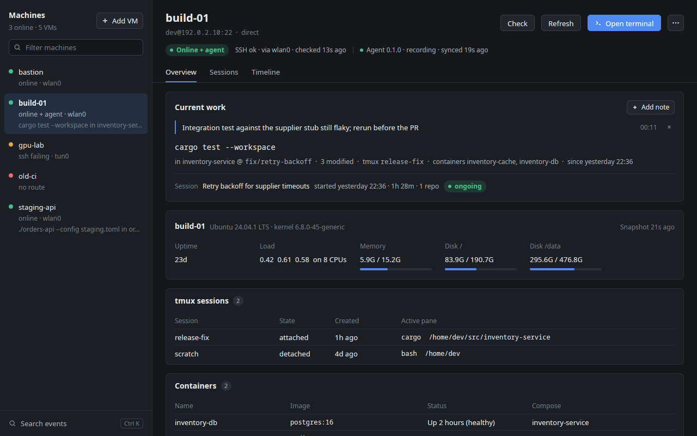
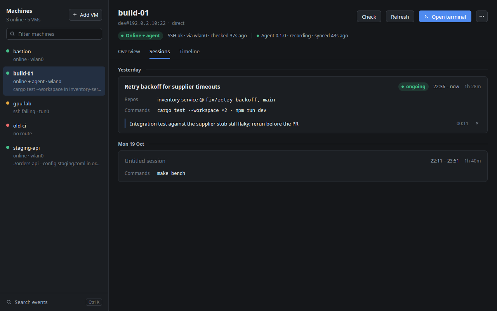
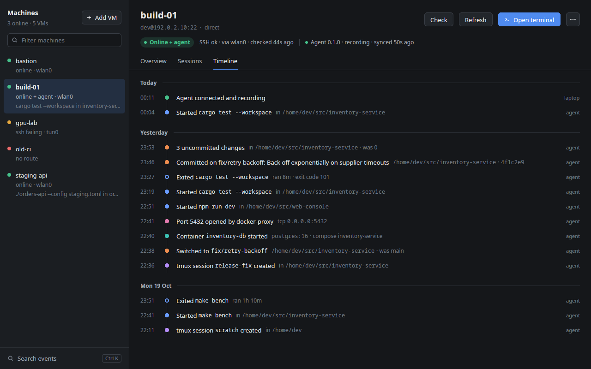
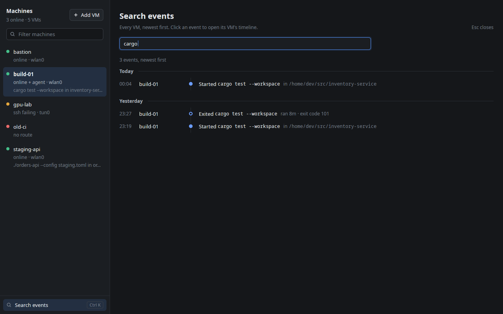

# VMDesk

VMDesk keeps track of the development VMs you work on: where each one is, how to reach it, what is
running there, and what you were doing on it. It is a native desktop app and a `vmdesk` CLI. Both
run on your laptop, keep their state in a local SQLite database, and reach every VM over SSH,
directly or through jump hosts. An optional agent on a VM records history while your laptop is
away.



Screenshots use a database of fictional VMs (see [Make demo data](#make-demo-data)).

## Status

| Milestone | Scope | State |
| --- | --- | --- |
| M0–M2 | Workspace, inventory, SSH transport over direct and jump paths | Done |
| M3 | Reachability: route inspection, status signals, network-change monitor | Done |
| M4 | SSH collector, snapshots, timeline | Done |
| M5 | Desktop app | Done |
| M6 | On-VM agent: history while the laptop is away | Done |
| M7 | Work sessions, current work, notes, event search | Done |
| M8 | Embedded terminal (libghostty) | Next |
| M9 | First cloud provider | Planned |

## Install

You need stable Rust (edition 2024, tested with 1.97) and Linux with a Vulkan GPU driver. macOS
should work for the CLI but is untested. On Debian or Ubuntu, the app also needs:

```sh
sudo apt install libxkbcommon-x11-dev libwayland-dev libx11-xcb-dev libfontconfig-dev \
  clang cmake fonts-noto-core fonts-noto-mono
```

Build the app and the CLI together, because the app runs `vmdesk proxy` and `vmdesk askpass` from
its own directory:

```sh
cargo build --release -p vmdesk-daemon -p vmdesk-app
# target/release/vmdesk       the CLI
# target/release/vmdesk-app   the desktop app
```

The first build of the app takes several minutes, because GPUI comes from Zed's `v1.24.2` release
tag. To install agents on VMs, also build the static agent and put it next to the binaries:

```sh
rustup target add x86_64-unknown-linux-musl
cargo build -p vmdesk-agent --profile agent --target x86_64-unknown-linux-musl
cp target/x86_64-unknown-linux-musl/agent/vmdesk-agent target/release/vmdesk-agent-x86_64
```

## Use the desktop app

```sh
target/release/vmdesk-app            # or: cargo run --release -p vmdesk-app
target/release/vmdesk-app build-01   # open with a VM selected (name, alias or id)
```

The list on the left shows every VM with a status dot (green online, amber SSH failing, red no
route, grey not checked), the interface that reaches it, and what you were doing there. Type to
filter the list, use ↑/↓ to move, and press Esc to clear the filter.

The selected VM has a status pill (`Online + agent`, `SSH failing`, and so on), the agent's state,
and three tabs:

- **Overview** starts with **Current work**: the command or tmux session you were using, its repo
  and branch with uncommitted changes, and since when. Your newest note on the session sits above
  it. **Add note** pins a note to the latest session. Cards for the system, tmux sessions,
  containers, listening ports, repos and processes follow.
- **Sessions** lists stretches of activity, newest first, with the repos and commands in each.
  Click a title to rename the session.
- **Timeline** tells each event as a sentence under a day header, with its source (`agent`,
  `ssh` or `laptop`).





**Search events**, at the foot of the list or with Ctrl+K, searches the events of every VM. Each
word must match the start of a word, so `upf` finds `pytest upf-tests/n4.py`. Click a result to
open that VM's timeline.



The header's buttons:

- **Check** re-runs the route and SSH check. **Refresh** collects a new snapshot. The open VM is
  also collected every 2 minutes while it is reachable.
- **Open terminal** starts your terminal with `ssh` over the same path VMDesk uses. The terminal
  is `$VMDESK_TERMINAL` if set (a command that takes the program to run, such as `ghostty -e`),
  else the first installed of Ghostty, `x-terminal-emulator`, Ptyxis, GNOME Terminal, kitty and
  xterm. For a VM with a stored password, `vmdesk askpass` answers the first password prompt
  from the keychain.
- **⋯** opens **Edit VM…**, **Remove VM…**, and **Install agent**, **Upgrade agent** or
  **Remove agent…**. Removing a VM deletes it from VMDesk with its history, host keys and stored
  password. The VM itself is not touched.
- **Review host key…** appears when a VM's host key is new or has changed. It shows the
  fingerprint and whether it matches your `~/.ssh/known_hosts`.

**+ Add VM** opens a form for the name, address, port, user, login method (ssh-agent and default
keys, a key file, or a password in the OS keychain) and an optional jump host.

The app runs the reachability monitor and the snapshot poller itself. Nothing else needs to be
running.

## Use the CLI

Name a VM by its name, alias or id. VMDesk reaches it over its connection paths in order, through
any jump hosts, so you never need its address, user or bastion.

```sh
# Inventory
vmdesk import --dry-run              # preview hosts from ~/.ssh/config
vmdesk import                        # import them; re-running refreshes them
vmdesk list                          # or: vmdesk list --tag ci, vmdesk list bastion
vmdesk add build-02 192.0.2.12 -l dev --via bastion   # repeat --via for a chain
vmdesk edit build-02 --key ~/.ssh/id_lab              # or --user, or --agent
vmdesk set-password build-02         # log in with a password from the OS keychain
vmdesk remove build-02

# Connect
vmdesk exec build-01 uname -a        # exits with the remote command's status
vmdesk exec build-01 -- ls -la /tmp
ssh -o ProxyCommand='vmdesk proxy %n' build-01        # plain ssh, scp or VS Code Remote

# Reachability
vmdesk status                        # check every VM now
vmdesk status --watch build-01       # keep checking and print changes

# State and history
vmdesk show build-01                 # collect now: current work, system, tmux, containers, ...
vmdesk show build-01 --cached        # the last snapshot, without connecting
vmdesk timeline build-01 -n 100

# Work
vmdesk sessions build-01
vmdesk sessions rename build-01 01a15a2d "Retry backoff"   # by id or its first characters
vmdesk note build-01 rerun the integration test before the PR
vmdesk notes build-01
vmdesk search cargo test --since 7d  # every VM, newest first

# Agent
vmdesk agent install build-01        # --binary <path> to pick the build
vmdesk agent status
vmdesk agent upgrade build-01
vmdesk agent uninstall build-01      # the history on this laptop is kept
```

`vmdesk show` starts with the current-work line:

```text
note: Integration test against the supplier stub still flaky; rerun before the PR
cargo test --workspace in inventory-service @ fix/retry-backoff (3 modified) · tmux release-fix · since 22:36
```

`vmdesk status` prints one line per VM:

```text
NAME         STATE                   SSH      AGENT    DETAIL
bastion      online (wlan0)          ok       unknown
build-01     online + agent (wlan0)  ok       ok
gpu-lab      ssh failing (tun0)      timeout  unknown  timed out: gpu-lab: 192.0.2.40:22: timed out
```

Logging in tries the VM's key file or keychain password, then ssh-agent, then
`~/.ssh/id_ed25519`, `id_ecdsa` and `id_rsa`. Load passphrase-protected keys into ssh-agent.

Host keys are checked on every hop. An unknown key is rejected with its fingerprint: check it,
then rerun with `--accept-new-host-keys`. A changed key always blocks the connection. If the VM
was reinstalled, run `vmdesk forget-host-key <vm>` and connect again with
`--accept-new-host-keys`.

Logs go to stderr (`RUST_LOG`, default `info`), so stdout carries only the command's output or the
proxied stream.

## How it works

**Reachability.** A check finds the laptop interface that routes to the VM (or its first jump
host), then logs in over the VM's path with a 3 s timeout per hop. The monitor checks every VM
when the laptop's addresses change (a VPN going up or down, a Wi-Fi switch), favourites every
minute, and the rest every five minutes. In the background, a VM whose last login failed only
gets a port check, so fail2ban does not ban the laptop.

**Snapshots.** Without an agent, one shell script runs over a single SSH exec and reports the
system, processes, Docker containers, tmux sessions, listening ports and git repos. Nothing is
installed on the VM. Processes are limited to your own work, and command lines are redacted
(`--password=`, `token=`, AWS keys). Each snapshot is compared with the previous one, and the
differences become timeline events. Snapshots are kept compressed: all from the last 48 hours,
then hourly for 30 days, then daily.

**The agent.** The SSH collector only sees what exists at each poll. The agent is a static binary
in `~/.local/share/vmdesk/agent/` on the VM, run as a `systemd --user` service (or a `nohup`
daemon where that is not available). It takes a snapshot every 30 seconds with the same script,
records the differences in a local event log, and hands the backlog over when the laptop connects
again. It opens no port: the laptop talks to it over the VM's SSH path. A repeated or interrupted
sync stores each event once. Upgrades are never automatic.

**Work sessions.** A session is a stretch of activity on one VM. An idle stretch of more than
2 hours starts a new one. Sessions stay up to date as events arrive, including agent history
that arrives late. The current-work line picks its subject from the latest snapshot: a command in
an attached tmux session first, then an attached session, then commands in other tmux panes or
SSH logins, then other recorded processes.

**Search.** Events are indexed with SQLite FTS5 over command lines, directories, repos,
branches, commit subjects, containers, tmux sessions and listening processes.

## Configuration

| Variable | Effect |
| --- | --- |
| `VMDESK_DATA_DIR` | Data directory (also `--data-dir` on the CLI) |
| `VMDESK_TERMINAL` | Terminal command for **Open terminal**, such as `ghostty -e` |
| `VMDESK_AGENT_BIN` | Agent build to install, instead of `vmdesk-agent-x86_64` next to the binaries |
| `VMDESK_ALL_GPU_DRIVERS` | `1` keeps every graphics driver loaded (needed only without a hardware Vulkan driver) |
| `VMDESK_NO_BACKGROUND` | `1` stops the app from connecting to VMs on its own, for demos |
| `RUST_LOG` | Log verbosity |

The data directory is `~/.local/share/vmdesk/` on Linux and `~/Library/Application Support/vmdesk/`
on macOS. It holds `vmdesk.db` (migrations run on start) and `ssh/`, the SSH configs that **Open
terminal** writes. Passwords live in the OS keychain (Secret Service, such as GNOME Keyring), and
the database stores only the entry name.

The app's release build uses about 70 MB. At start it re-executes itself once with the graphics
loaders limited to the Vulkan drivers of the GPUs present, which saves about 55 MB of Mesa GL and
`libLLVM`. Programs it starts, such as the terminal, get the normal environment back.

## Develop

```sh
cargo test --workspace
cargo clippy --workspace --all-targets -- -D warnings
cargo fmt --all
```

Plain `cargo build` and `cargo test` cover only `vmdesk-daemon`, the default member. The app's
tests drive a real window headlessly through GPUI's test platform on an in-memory database.

GPUI is pinned to a Zed release tag in the workspace `Cargo.toml`. Bump it deliberately, because
GPUI's API changes between releases. Add a new numbered file under `migrations/` rather than
editing an applied one: a changed migration makes existing databases fail with a checksum error.

### Make demo data

The seeder writes a database of fictional VMs. Every name, address (RFC 5737 documentation
ranges), process and repo in it is invented:

```sh
cargo run -p vmdesk-db --example demo_data -- /tmp/vmdesk-demo
VMDESK_DATA_DIR=/tmp/vmdesk-demo VMDESK_NO_BACKGROUND=1 target/release/vmdesk-app build-01
```

The screenshots in `docs/screenshots/` come from that database, rendered on Xvfb.

### Repository layout

```text
crates/
  vmdesk-proto/       Snapshot, event and wire-protocol types shared with the agent
  vmdesk-core/        Domain model and traits: Provider, HopConnector, Collector
  vmdesk-db/          SQLite: inventory, provider sync, status, snapshots, timeline,
                      work sessions, notes, search
  vmdesk-providers/   Static and SSH config providers
  vmdesk-transport/   SSH transport: path builder, session cache, host keys, login
  vmdesk-reach/       Route lookup, reachability checks, network-change monitor
  vmdesk-collect/     Probe script and parser, snapshot diff, SSH collector, agent sync and
                      install, poller, current-work summary
  vmdesk-agent/       The on-VM agent
  vmdesk-daemon/      The `vmdesk` CLI
  vmdesk-app/         The desktop app (GPUI)
migrations/           SQLx migrations, embedded at compile time
docs/screenshots/     README screenshots, from the demo data
```
