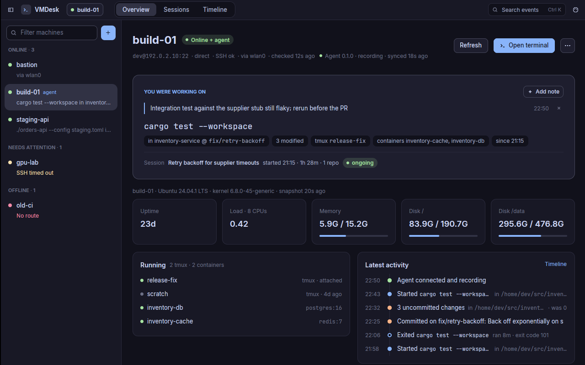
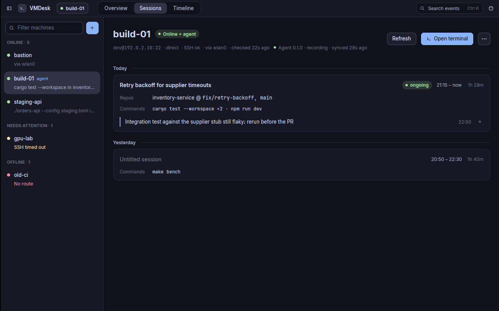
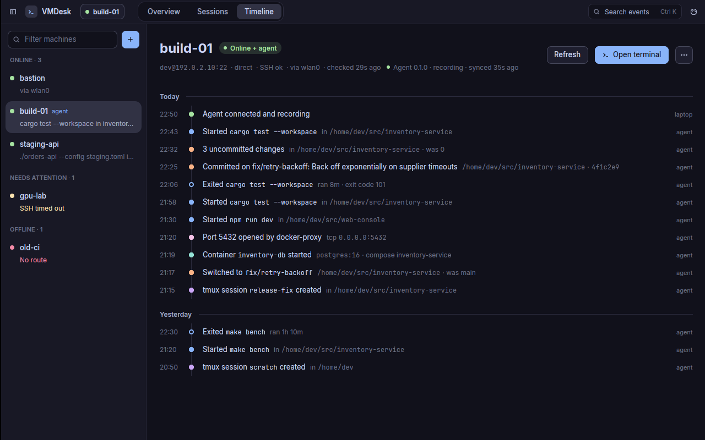
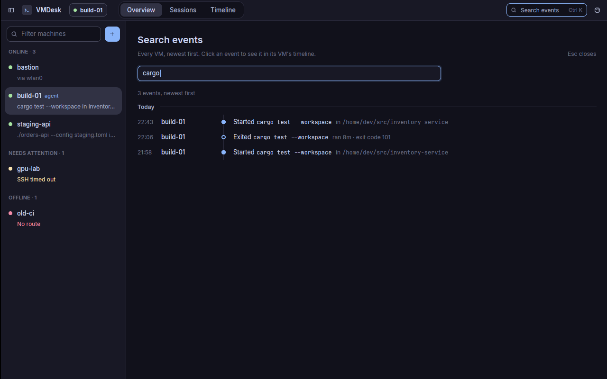
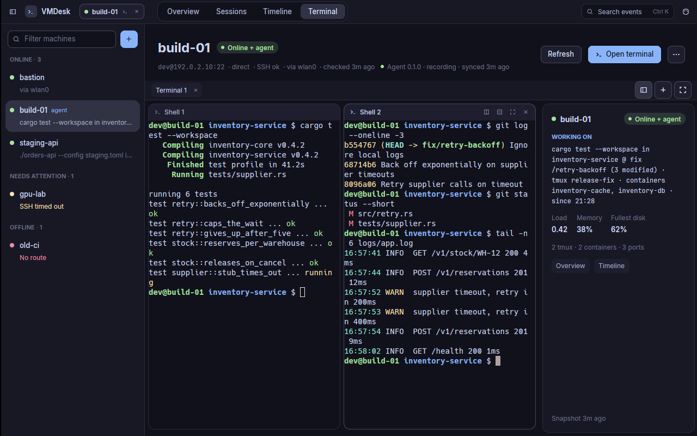

# VMDesk

VMDesk keeps track of the development VMs you work on: where each one is, how to reach it, what is
running there, and what you were doing on it. It is a native desktop app and a `vmdesk` CLI. Both
run on your laptop, keep their state in a local SQLite database, and reach every VM over SSH,
directly or through jump hosts. The app has a built-in terminal with tabs and splits, so a shell
on any VM is one click away. An optional agent on a VM records history while your laptop is
away.



Screenshots use a database of fictional VMs (see [Make demo data](#make-demo-data)).

## Status

| Milestone | Scope | State |
| --- | --- | --- |
| M0–M2 | Workspace, inventory, SSH transport over direct and jump paths | Done |
| M3 | Reachability: route inspection, status signals, network-change monitor | Done |
| M4 | SSH collector, snapshots, timeline | Done |
| M5 | Desktop app | Done |
| M6 | On-VM agent: history while the laptop is away | Done |
| M7 | Work sessions, current work, notes, event search | Done |
| M8 | Built-in terminal (libghostty) with tabs and splits | Done |
| M9 | First cloud provider | Planned |

## Install

You need stable Rust (edition 2024, tested with 1.97) and Linux with a Vulkan GPU driver. macOS
should work for the CLI but is untested.

1. Install the system libraries the app builds against (Debian or Ubuntu):

   ```sh
   sudo apt install libxkbcommon-x11-dev libwayland-dev libx11-xcb-dev libfontconfig-dev \
     clang cmake pkg-config
   ```

2. Build **libghostty-vt**, Ghostty's terminal library, once (needs [Zig](https://ziglang.org)):

   ```sh
   git clone https://github.com/ghostty-org/ghostty && cd ghostty
   zig build -Demit-lib-vt -Doptimize=ReleaseFast --prefix ~/.local
   ```

   The build finds it with pkg-config (`~/.local/share/pkgconfig` is searched too; set
   `PKG_CONFIG_PATH` for another prefix) and links it statically, so the app does not need it
   at run time.

3. Add the musl target, so the on-VM agent can be built too, and install:

   ```sh
   rustup target add x86_64-unknown-linux-musl
   ./install.sh              # build, then install for your user
   ./install.sh uninstall    # remove it again
   ```

`install.sh` puts `vmdesk-app`, `vmdesk` and the agent `vmdesk-agent-x86_64` side by side in
`~/.local/bin`, a **VMDesk** launcher in your apps, and its icon in
`~/.local/share/icons/hicolor`, so you can start it from the app grid or pin it to the dock. Run
it again after pulling changes. Uninstalling keeps your VMs and history.

To build without installing:

```sh
cargo build --release -p vmdesk-daemon -p vmdesk-app
cargo build -p vmdesk-agent --profile agent --target x86_64-unknown-linux-musl
cp target/x86_64-unknown-linux-musl/agent/vmdesk-agent target/release/vmdesk-agent-x86_64
```

Build the app and the CLI together: the app runs `vmdesk proxy` and `vmdesk askpass`, and
uploads the agent, from its own directory. The first build takes several minutes, because GPUI
comes from Zed's `v1.24.2` release tag.

## Use the desktop app

```sh
vmdesk-app            # or: target/release/vmdesk-app, or the VMDesk launcher
vmdesk-app build-01   # open with a VM selected (name, alias or id)
```

The window has three parts:

- **The machine list** on the left groups your VMs into **Online**, **Needs attention** and
  **Offline**. Each shows a status dot and one line: what you were doing there, or why it cannot
  be reached. Type to filter, use ↑/↓ to move, and press Esc to clear the filter. **+** adds a VM.
- **The top bar** holds a tab per open machine (the selected one, and every machine whose
  shells are running), the selected machine's views, **Search events** and the theme picker.
- **The machine page** shows the VM's name and state, one line with its login, path, SSH result
  and agent, and the open view.

The app checks reachability and collects snapshots itself, in the background. Nothing else
needs to be running.

### The views

- **Overview** starts with **You were working on**: the command or tmux session you were using,
  its repo and branch with uncommitted changes, and since when, under your newest note.
  **Add note** pins a note to the session. Tiles for uptime, load, memory and each disk follow,
  then what runs there beside the latest activity, then the listening ports, repos and processes.
- **Sessions** lists stretches of activity, newest first, with the repos and commands in each.
  Click a title to rename the session.
- **Timeline** tells each event as a sentence under a day header, with its source (`agent`,
  `ssh` or `laptop`). It shows the newest 300 events; **Show older events** loads more.
- **Terminal** holds the machine's shells; see [The built-in terminal](#the-built-in-terminal).





### Search

**Search events** (Ctrl+K) searches the events of every VM. Each word must match the start of a
word, so `upf` finds `pytest upf-tests/n4.py`. Click a result to open that VM's Timeline at the
event, however old; **Back to latest** returns to the newest events.



### The built-in terminal

**Open terminal** opens a shell on the selected VM inside VMDesk, over the same SSH path the app
uses, jump hosts included. Nothing extra runs on the VM. The terminal is Ghostty's terminal core,
so `vim`, `top`, `htop`, `tmux` and other full-screen programs work, with true colour, mouse
support and bracketed paste, and resizing the window resizes the remote pty.



- **Splits.** Each shell is a card. Split it to the right or below, as often as you like. Zoom
  shows one shell alone and brings the splits back on the second press.
- **Tabs.** The strip above the shells holds one tab per set of shells; **+** opens another.
- **Several machines at once.** A machine's shells keep running while you look at another
  machine; its tab in the top bar brings them back, and the tab's × closes them.
- **Inspector.** The panel on the right shows the machine's state beside its shells: what you
  were working on, load, memory, the fullest disk and what runs there.
- **Closing.** `exit` or Ctrl+D closes the shell's card, and the last card closes the tab. A
  dropped connection keeps the card, with **Reconnect**.
- **Scrollback and copy.** The wheel scrolls back (or reaches a program that reads the mouse),
  Shift+PageUp/PageDown page, and typing returns to the bottom. Selecting text copies it to the
  primary selection, which a middle click pastes. A multi-line paste asks first unless the
  program turned on bracketed paste.

Prompts with Powerline or Nerd Font glyphs need such a font on the machine running VMDesk. The
terminal uses the first installed Nerd Font it knows, else the built-in JetBrains Mono;
`VMDESK_TERM_FONT` picks another. **Open in external terminal** in the **⋯** menu starts your own
terminal app with `ssh` instead: `$VMDESK_TERMINAL` if set (such as `ghostty -e`), else the first
installed of Ghostty, `x-terminal-emulator`, Ptyxis, GNOME Terminal, kitty and xterm.

### Manage machines

- **+** opens a form for the name, address, port, user, login method (ssh-agent and default
  keys, a key file, or a password in the OS keychain) and an optional jump host.
- **Refresh** collects a new snapshot. The open VM is also collected every 2 minutes while it is
  reachable.
- **⋯** holds **Check now**, **Edit VM…**, **Open in external terminal**, **Remove VM…**, and
  **Install agent**, **Upgrade agent** or **Remove agent…**. Removing a VM deletes it from
  VMDesk with its history, host keys and stored password; the VM itself is not touched.
- **Review host key…** appears when a VM's host key is new or has changed. It shows the
  fingerprint and whether it matches your `~/.ssh/known_hosts`.

### Themes

The palette button in the top bar (Ctrl+Shift+P) opens the theme picker: VMDesk Dark (the
default), VMDesk Light, and every Ghostty theme installed on the machine (Ghostty's own and any
in `~/.config/ghostty/themes`). Type to filter, and click a theme to use it at once, terminals
included. The choice is saved and used at the next start; `VMDESK_THEME` picks one for a single
run. Ghostty's themes are read only when the picker opens.

### Keyboard shortcuts

| Keys | Does |
| --- | --- |
| Ctrl+K | Search events |
| Ctrl+Shift+P | Theme picker |
| Ctrl+Shift+B | Fold the machine list to a rail, or unfold it |
| Ctrl+Shift+D / Ctrl+Shift+E | Split the shell to the right / below |
| Ctrl+Shift+Z | Zoom the shell, or bring its splits back |
| Ctrl+Shift+T / Ctrl+Shift+W | New tab of shells / close the shell |
| Ctrl+Shift+M | Fill the window with the terminal, or restore |
| Ctrl+Shift+I | Show or hide the inspector |
| Ctrl+Shift+C / Ctrl+Shift+V | Copy / paste in the terminal |

## Use the CLI

Name a VM by its name, alias or id. VMDesk reaches it over its connection paths in order, through
any jump hosts, so you never need its address, user or bastion.

```sh
# Inventory
vmdesk import --dry-run              # preview hosts from ~/.ssh/config
vmdesk import                        # import them; re-running refreshes them
vmdesk list                          # or: vmdesk list --tag ci, vmdesk list bastion
vmdesk add build-02 192.0.2.12 -l dev --via bastion   # repeat --via for a chain
vmdesk edit build-02 --key ~/.ssh/id_lab              # or --user, or --agent
vmdesk set-password build-02         # log in with a password from the OS keychain
vmdesk remove build-02

# Connect
vmdesk exec build-01 uname -a        # exits with the remote command's status
vmdesk exec build-01 -- ls -la /tmp
ssh -o ProxyCommand='vmdesk proxy %n' build-01        # plain ssh, scp or VS Code Remote

# Reachability
vmdesk status                        # check every VM now
vmdesk status --watch build-01       # keep checking and print changes

# State and history
vmdesk show build-01                 # collect now: current work, system, tmux, containers, ...
vmdesk show build-01 --cached        # the last snapshot, without connecting
vmdesk timeline build-01 -n 100

# Work
vmdesk sessions build-01
vmdesk sessions rename build-01 01a15a2d "Retry backoff"   # by id or its first characters
vmdesk note build-01 rerun the integration test before the PR
vmdesk notes build-01
vmdesk search cargo test --since 7d  # every VM, newest first

# Agent
vmdesk agent install build-01        # --binary <path> to pick the build
vmdesk agent status
vmdesk agent upgrade build-01
vmdesk agent uninstall build-01      # the history on this laptop is kept
```

`vmdesk show` starts with the current-work line:

```text
note: Integration test against the supplier stub still flaky; rerun before the PR
cargo test --workspace in inventory-service @ fix/retry-backoff (3 modified) · tmux release-fix · since 22:36
```

`vmdesk status` prints one line per VM:

```text
NAME         STATE                   SSH      AGENT    DETAIL
bastion      online (wlan0)          ok       unknown
build-01     online + agent (wlan0)  ok       ok
gpu-lab      ssh failing (tun0)      timeout  unknown  timed out: gpu-lab: 192.0.2.40:22: timed out
```

`vmdesk timeline` (oldest first) and `vmdesk search` (newest first) tell each event in the
words of the app's Timeline:

```text
WHEN         CATEGORY  SOURCE  EVENT                           DETAIL
10-21 00:16  git       agent   3 uncommitted changes           in /home/dev/src/inventory-service · was 0
10-21 00:27  process   agent   Started cargo test --workspace  in /home/dev/src/inventory-service
10-21 00:34  status    laptop  Agent connected and recording
```

Logging in tries the VM's key file or keychain password, then ssh-agent, then
`~/.ssh/id_ed25519`, `id_ecdsa` and `id_rsa`. Load passphrase-protected keys into ssh-agent.

Host keys are checked on every hop. An unknown key is rejected with its fingerprint: check it,
then rerun with `--accept-new-host-keys`. A changed key always blocks the connection. If the VM
was reinstalled, run `vmdesk forget-host-key <vm>` and connect again with
`--accept-new-host-keys`.

Logs go to stderr (`RUST_LOG`, default `info`), so stdout carries only the command's output or the
proxied stream.

## How it works

**Reachability.** A check finds the laptop interface that routes to the VM (or its first jump
host), then logs in over the VM's path with a 3 s timeout per hop. The monitor checks every VM
when the laptop's addresses change (a VPN going up or down, a Wi-Fi switch), favourites every
minute, and the rest every five minutes. In the background, a VM whose last login failed only
gets a port check, so fail2ban does not ban the laptop.

**Snapshots.** Without an agent, one shell script runs over a single SSH exec and reports the
system, processes, Docker containers, tmux sessions, listening ports and git repos. Nothing is
installed on the VM. Processes are limited to your own work, and command lines are redacted
(`--password=`, `token=`, AWS keys). Each snapshot is compared with the previous one, and the
differences become timeline events. Snapshots are kept compressed: all from the last 48 hours,
then hourly for 30 days, then daily.

**The agent.** The SSH collector only sees what exists at each poll. The agent is a static binary
in `~/.local/share/vmdesk/agent/` on the VM, run as a `systemd --user` service (or a `nohup`
daemon where that is not available). It takes a snapshot every 30 seconds with the same script,
records the differences in a local event log, and hands the backlog over when the laptop connects
again. It opens no port: the laptop talks to it over the VM's SSH path. A repeated or interrupted
sync stores each event once. Upgrades are never automatic.

**Work sessions.** A session is a stretch of activity on one VM. An idle stretch of more than
2 hours starts a new one. Sessions stay up to date as events arrive, including agent history
that arrives late. The current-work line picks its subject from the latest snapshot: a command in
an attached tmux session first, then an attached session, then commands in other tmux panes or
SSH logins, then other recorded processes.

**Search.** Events are indexed with SQLite FTS5 over command lines, directories, repos,
branches, commit subjects, containers, tmux sessions and listening processes.

## Configuration

| Variable | Effect |
| --- | --- |
| `VMDESK_DATA_DIR` | Data directory (also `--data-dir` on the CLI) |
| `VMDESK_TERMINAL` | External terminal command for **Open in external terminal**, such as `ghostty -e` |
| `VMDESK_THEME` | Theme to use for this run, by name, such as `VMDesk Light` or `Gruvbox Dark` |
| `VMDESK_TERM_FONT` | Font family for the built-in terminal (default: the first installed Nerd Font Mono it knows, else the built-in JetBrains Mono) |
| `VMDESK_TERM_FONT_SIZE` | Font size in pixels for the built-in terminal (default: 14) |
| `VMDESK_SCROLL_LINES` | Lines per wheel notch in the built-in terminal (default: 3) |
| `VMDESK_AGENT_BIN` | Agent build to install, instead of `vmdesk-agent-x86_64` next to the binaries |
| `VMDESK_ALL_GPU_DRIVERS` | `1` keeps every graphics driver loaded (needed only without a hardware Vulkan driver) |
| `VMDESK_NO_BACKGROUND` | `1` stops the app from connecting to VMs on its own, for demos |
| `RUST_LOG` | Log verbosity |

The data directory is `~/.local/share/vmdesk/` on Linux and `~/Library/Application Support/vmdesk/`
on macOS. It holds `vmdesk.db` (migrations run on start), `settings.json` (the theme) and `ssh/`,
the SSH configs that **Open in external terminal** writes. Passwords live in the OS keychain (Secret Service, such as GNOME Keyring), and
the database stores only the entry name.

The app uses about 110 MB and next to no CPU when idle. At start it re-executes itself once with
the graphics loaders limited to the Vulkan drivers of the GPUs present, which saves about 55 MB
of Mesa GL and `libLLVM`. Programs it starts, such as an external terminal, get the normal
environment back.

## Develop

```sh
cargo test --workspace
cargo clippy --workspace --all-targets -- -D warnings
cargo fmt --all
```

Plain `cargo build` and `cargo test` cover only `vmdesk-daemon`, the default member. The app's
tests drive a real window headlessly through GPUI's test platform on an in-memory database.

GPUI is pinned to a Zed release tag in the workspace `Cargo.toml`. Bump it deliberately, because
GPUI's API changes between releases. Add a new numbered file under `migrations/` rather than
editing an applied one: a changed migration makes existing databases fail with a checksum error.

### Make demo data

The seeder writes a database of fictional VMs. Every name, address (RFC 5737 documentation
ranges), process and repo in it is invented:

```sh
cargo run -p vmdesk-db --example demo_data -- /tmp/vmdesk-demo
VMDESK_DATA_DIR=/tmp/vmdesk-demo VMDESK_NO_BACKGROUND=1 target/release/vmdesk-app build-01
```

The screenshots in `docs/screenshots/` come from that database, rendered on Xvfb.

### Repository layout

```text
crates/
  vmdesk-proto/       Snapshot, event and wire-protocol types shared with the agent
  vmdesk-core/        Domain model and traits: Provider, HopConnector, Collector
  vmdesk-db/          SQLite: inventory, provider sync, status, snapshots, timeline,
                      work sessions, notes, search; each event in words
  vmdesk-providers/   Static and SSH config providers
  vmdesk-transport/   SSH transport: path builder, session cache, host keys, login
  vmdesk-reach/       Route lookup, reachability checks, network-change monitor
  vmdesk-collect/     Probe script and parser, snapshot diff, SSH collector, agent sync and
                      install, poller, current-work summary
  vmdesk-agent/       The on-VM agent
  vmdesk-terminal/    The built-in terminal's core: libghostty-vt bindings (the one crate
                      allowed `unsafe`)
  vmdesk-daemon/      The `vmdesk` CLI
  vmdesk-app/         The desktop app (GPUI)
migrations/           SQLx migrations, embedded at compile time
docs/screenshots/     README screenshots, from the demo data
packaging/            The launcher entry and icons that install.sh installs
```
